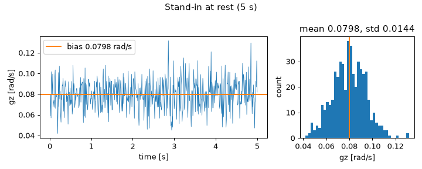

# 02. IMU の基礎

## この章でわかること

- 加速度計とジャイロが、それぞれ何を測るか。静止しているのに +1 g が出る理由。
- センサーの生の数字（LSB）を、m/s^2 と rad/s に直す方法。
- バイアス・雑音・ドリフト。積分すると何が起きるか。
- 静止ログからバイアスと標準偏差を出す手順。軸の向きの確かめ方。
- ヨー角速度の制御なら IMU だけで足りる理由。位置には足りない理由。

## IMU とは

IMU（慣性計測装置）は、加速度計とジャイロを 1 つにした部品です。
この教材の想定は 6 軸の LSM6DS3TR-C です。加速度 3 軸と角速度 3 軸を測ります。
（XIAO の型番と、載っている IMU の確定は 03 章です。IMU の I2C アドレスは 0x6A に固定で、これは Seeed の基板データによります。03 章 3.5 節。）

軸の向きは `Obs` の約束に揃えます。機体座標で x が前、y が左、z が上です（右手系）。

## 加速度計が測るもの: 比力

加速度計は「加速度」そのものではなく、**比力**（specific force）を測ります。
比力は、重力以外の力によって生まれる加速度です。

式で書くと、

```text
測った値 = 本当の加速度 − 重力加速度
```

です（どちらもベクトル）。重力加速度は下向き、つまり z 上向きの座標で `(0, 0, −9.81)` です。

机の上で静止している車を考えます。本当の加速度は 0 です。

```text
測った値 = 0 − (0, 0, −9.81) = (0, 0, +9.81)
```

だから静止時に `az ≈ +9.81`（+1 g）が出ます。
言葉で言うと「机が車を上へ押し返している力」を測っています。
反対に、自由落下している間は 0 になります。

`Obs` のコメント「静止時 az ≈ +9.81」はこのことです。

## ジャイロが測るもの: 角速度

ジャイロは、各軸まわりに回る速さ（角速度）を測ります。単位は rad/s です。
`gz` はz 軸（上向き）まわりの回転、つまり上から見た回転です。これがヨー角速度です。
右手の親指を z（上）に向けると、残りの指が曲がる向き、つまり上から見て反時計回り（左旋回）が正です。
`Obs` の「`gz > 0` が左旋回」はこれです。

ジャイロは重力を感じません。静止していれば、理想的には 0 です。

## 単位と尺度: LSB から物理量へ

センサーは 16 ビットの整数（LSB 単位）を出します。
1 LSB が何の物理量に当たるかを **感度**（sensitivity）と呼びます。
感度は、選んだ測定範囲（フルスケール）で変わります。範囲を広げると、1 LSB が粗くなります。

ST の LSM6DS3 データシートの値（下の出典）:

| 加速度の範囲 | 感度 |
|---|---|
| ±2 g | 0.061 mg/LSB |
| ±4 g | 0.122 mg/LSB |
| ±8 g | 0.244 mg/LSB |
| ±16 g | 0.488 mg/LSB |

| 角速度の範囲 | 感度 |
|---|---|
| ±125 dps | 4.375 mdps/LSB |
| ±245 dps | 8.75 mdps/LSB |
| ±500 dps | 17.50 mdps/LSB |
| ±1000 dps | 35 mdps/LSB |
| ±2000 dps | 70 mdps/LSB |

この表は無印 LSM6DS3 のデータシートの表から取った値です（出典 1）。
TR-C については、XIAO 用の Seeed Arduino LSM6DS3 ライブラリ（2.0.8）が TR-C（WHO_AM_I 0x6A）も同じ換算で扱っています（出典 4）。
ライブラリは加速度を `raw × 0.061 × (範囲 g ÷ 2)` mg、角速度を `raw × 4.375 × (範囲 dps ÷ 125)` mdps で換算し、角速度の範囲の選択肢を 125・245・500・1000・2000 と書いています（245 のときは 4.375 × 2 = 8.75）。
上の表と一致します。
【未確認】TR-C のデータシートそのもので表記（±245 か ±250 か）を確かめられていません（ST のサイトは取得がタイムアウト）。ライブラリの表記は ±245 です。

**このスケッチが実際に使う範囲**: 03 章のスケッチ（`firmware/xiao_imu_drive/xiao_imu_drive.ino`）は、範囲も出力レートも設定せず、ライブラリの既定のまま `imu.begin()` を呼びます。既定は次のとおりです（出典 4）。

| 量 | 既定の範囲 | 感度 | センサーの出力レート |
|---|---|---|---|
| 加速度 | ±16 g | 0.488 mg/LSB（約 0.0048 m/s^2） | 416 Hz |
| 角速度 | ±2000 dps | 70 mdps/LSB（約 0.0012 rad/s） | 416 Hz |

スケッチはこれを 10 ms ごと（100 Hz）に読み、`readFloatAccel*` の g に 9.80665 を、`readFloatGyro*` の dps に π/180 を掛けて、m/s^2 と rad/s で送ります。
ログの値は、すでにこの単位です。下の換算式は、生の値から自分で計算するときのためのものです。

変換は、生の値に感度を掛け、単位を直すだけです。

```text
加速度 [m/s^2] = raw × 0.061e-3 × 9.80665      （±2 g のとき）
角速度 [rad/s] = raw × 8.75e-3 × π / 180        （±245 dps のとき）
```

- mg は 1/1000 g。g は 9.80665 m/s^2。
- mdps は 1/1000 度毎秒（dps）。度をラジアンにするには π/180 を掛けます。

ST のコミュニティでは、角速度の感度は「フルスケール ÷ 32768」とわずかに違い、データシートの値を使うよう回答されています（出典 3）。

範囲の選び方の目安（推測）: 小さな車のヨー角速度は、速くても数百 dps くらいです。±500 dps あたりなら、はみ出さず、細かさも十分そうです。いまのスケッチは既定の ±2000 dps なので、はみ出す心配はほぼなく、そのぶん 1 LSB が粗くなっています（70 mdps）。範囲を変えるなら、スケッチで `imu.begin()` の前に `imu.settings.gyroRange` を設定します（ライブラリの `settings` の項目。スケッチの変更は 03 章の範囲です）。
はみ出す（飽和する）と、値が範囲の端で止まり、同定が狂います。ログで端に張りついていないか確かめてください。

## バイアス・雑音・ドリフト

実際のセンサーの値は、こう書けます。

```text
測った値 = 本当の値 + バイアス + 雑音
```

- **バイアス**: いつも同じ向きにずれる分。静止していてもジャイロが 0 にならない原因です。
- **雑音**: 毎回ばらばらに揺れる分。平均すると 0 に近づきます。
- **ドリフト**: バイアスがゆっくり変わること。温度や電源投入からの時間で動きます。

## 積分すると何が起きるか

ジャイロの `gz` を時間で足し合わせる（積分する）と、向き（ヨー角）が出ます。
しかし、バイアスも一緒に足し合わされます。

例: バイアスが 0.01 rad/s（約 0.57 度毎秒）なら、

```text
60 秒後のずれ = 0.01 × 60 = 0.6 rad（約 34 度）
```

ずれは時間に比例して増え続けます。雑音も積分すると、ゆっくり広がっていきます（ランダムウォーク）。

加速度を 2 回積分して位置を出すと、もっとひどくなります。
バイアスが `a_b` なら、位置のずれは `a_b·t²/2` で、時間の 2 乗で増えます。
`a_b = 0.05 m/s^2` でも、10 秒で 2.5 m ずれます。
さらに、少しでも傾くと重力の一部が「前向きの加速度」に見えてしまいます。

## 静止ログからバイアスと標準偏差を出す

手順です。

1. 車を平らな机に置く。モーターは止めたまま（duty 0）。
2. 電源を入れて、数十秒待つ（温度が落ち着くまで。どのくらい待つかは要確認。自分の個体で測るのがよい）。
3. 30〜60 秒ほど、ログを取る（取り方は 03 章）。例: `python -m physlearn.link still --port /dev/ttyACM0 --out still.csv --seconds 60`（`--seconds` の既定は 10 秒）。
4. 各列の平均と標準偏差を計算する。

ログの CSV は 1 行目が見出しで、列は `t,ax,ay,az,gx,gy,gz,left,right`（`LOG_COLUMNS`）です。
`t` は秒、加速度は m/s^2、角速度は rad/s、軸は機体の軸（`--axes` で基板の軸から並べ替えた後）です（`src/physlearn/api.py`、`src/physlearn/link.py`、`doc/protocol.md`）。

numpy での例（見出しの行を列名として読みます）:

```python
import numpy as np

d = np.genfromtxt("still.csv", delimiter=",", names=True)
for c in ["ax", "ay", "az", "gx", "gy", "gz"]:
    print(c, d[c].mean(), d[c].std())
```

読み方:

- `gx`・`gy`・`gz` の平均が、ジャイロのバイアスです。制御では、この値を引いてから使います。
- `ax`・`ay` の平均は 0 に近く、`az` の平均は +9.81 に近いはずです。ずれは、バイアスか、机の傾きか、IMU の付け方の傾きです。
- 標準偏差が雑音の大きさです。sim の IMU モデル（04 章）に、この値を入れます。
- 時間を置いて 2 回測り、平均がどれだけ動くかを見ると、ドリフトの目安になります。



上の図は、実機の代役（sim）を 5 秒止めたときの gz です。0 ではなく 0.08 rad/s のまわりに散らばり、平均がバイアス、ヒストグラムの幅（標準偏差 0.014）が雑音の大きさです。

この例は、実機の代わりに `uv run --extra mujoco physlearn sim-log --plant mujoco mj.csv` で作った同じ列の CSV で動くことを確かめました。sim のログは静止ではなく旋回を含むので、`gz` の平均は 0 になりません。

## 軸の向きを確かめる

基板の印刷と、車への付け方で、軸の向きは簡単に入れ替わります。必ず実物で確かめます。

**基板データからの読み（実物では未確認）**: XIAO nRF52840 Sense の IMU は、Seeed の KiCad の基板データと ST のデータシートの軸の図を重ねて読むと、基板の部品面（USB-C と同じ面）にあり、基板の中心から USB-C 側へ 1.59 mm、横へ 4.57 mm の所です（基板の外形は 20.955 × 17.78 mm）。USB-C を前に向け、部品面を上にして置いたとき、機体 x = −Y_imu、機体 y = +X_imu、機体 z = +Z_imu で、`link` の `--axes` では `--axes=-y,x,z` になります。これは図面の読みで、**実物ではまだ確かめていません**（調査: `doc/research/2026-11-19-dimensions.md` の 2 節。3.7 節も見る）。

`--axes` の値が `-` で始まるときは、`--axes -y,x,z` ではなく **`--axes=-y,x,z`** と `=` でつなぎます（空白だと argparse に拒まれます）。実機では、`uv run python -m physlearn.hwcheck axes --port /dev/ttyACM0` が、車体を水平・前を上・左を上に置いた加速度から `--axes` の文字列を割り出します（03 章 3.7。実機では走らせていません）。下の 4 つは、その結果を目で確かめる手順です。

1. **z（上）**: 平らに置いて `az ≈ +9.81`。裏返すと `az ≈ −9.81`。
2. **x（前）**: 車の前を下に向けて立てる（鼻先を床に）。このとき前が下なので、`ax ≈ −9.81`。後ろを下にすると `ax ≈ +9.81`。
3. **y（左）**: 右側を下にして立てると、左が上なので `ay ≈ +9.81`。
4. **gz の向き**: 平らに置いて、上から見て反時計回り（左回り）に手で回す。`gz > 0` なら正しい。

符号や軸が違ったら、境界の内側（ファームウェアか実機側の `Plant`）で入れ替えて、`Obs` の約束に合わせます。
制御器の側では直しません。

## ヨー角速度なら IMU だけで足りる理由

この教材の課題は「`ωz` を目標値に合わせる」ことです。

- ジャイロの `gz` は、`ωz` そのものを直接測っています。積分は要りません。
- だから、バイアスを引けば、ずれは時間とともに増えません。
- 雑音はありますが、制御の性能に効くくらい大きいかは、静止ログの標準偏差で判断できます。

一方、位置（どこまで進んだか）や向き（何度回ったか）は、積分しないと出ません。
上で見たとおり、積分するとずれが増え続けます。
特に位置は、加速度の 2 回積分なので、数秒で使いものにならなくなります。
位置を扱うには、エンコーダー・カメラなど、別の観測を足す必要があります（10 章）。

## 演習

1. ±2 g の範囲で、静止時の `az` の生の値はおよそいくつになりますか。
   - 手がかり: 1 g = 1000 mg。1000 ÷ 0.061。
2. 静止ログで `gz` の平均が 0.004 rad/s、標準偏差が 0.002 rad/s でした。バイアスを引かずに 5 分積分すると、向きはどれだけずれますか。
   - 手がかり: 0.004 × 300 rad。度に直すと？
3. 机が少し傾いていると、静止ログの何が変わりますか。それをジャイロのバイアスと見分けられますか。
   - 手がかり: 傾きは加速度計の `ax`・`ay` に重力の一部として出ます。ジャイロは重力を感じません。

## 出典

取得: JST 2026-11-19 13:36 ごろ（検索結果の要約で確認。PDF 本文は未取得）。

1. ST, LSM6DS3 データシート（alldatasheet.net の写し）. https://www.alldatasheet.net/html-pdf/796179/STMICROELECTRONICS/LSM6DS3/38994/20/LSM6DS3.html
2. ST, LSM6DS3TR-C 製品ページ. https://www.st.com/content/st_com/en/products/mems-and-sensors/inemo-inertial-modules/lsm6ds3tr-c.html （取得はタイムアウト。中身は未確認）
3. ST Community, "Is it an error in the datasheet of LSM6DS3TR-C?". https://community.st.com/mems-sensors-48/is-it-an-error-in-the-datasheet-of-lsm6ds3tr-c-19304
4. Seeed Arduino LSM6DS3 2.0.8 のソース `LSM6DS3.cpp`（`calcAccel`・`calcGyro`・既定の `settings`）。arduino-cli で入れたものを読んだ。https://github.com/Seeed-Studio/Seeed_Arduino_LSM6DS3

## 次の章

[03. 部品・配線・XIAO のスケッチ・ログ取り](03-hardware-firmware.md)
（実機を動かす前に [09. 安全](09-safety.md) を読んでください。）
