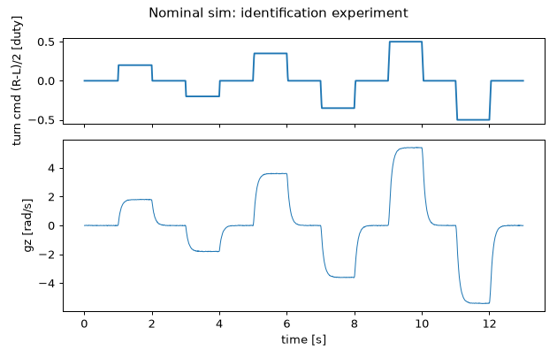

# 04 sim を作る — 差動 2 輪と IMU のモデル

この章では、XIAO + IMU + 2 輪の小さな車体を numpy だけで真似る sim（`src/physlearn/sim.py`）を読みます。
sim は実機と同じ `Plant`（`reset()` と `step(cmd, dt)`）を実装しているので、制御器から見ると実機と区別がつきません。

## 車体の図

```
        前 (x)
         ↑
   ┌─────┴─────┐
 ■ │  XIAO+IMU │ ■      ■ = 車輪 (半径 r)
   └───────────┘
 ←──── トレッド b ────→
 左 (left)        右 (right)

 y は左向き、z は上向き。gz > 0 は左旋回（上から見て反時計回り）。
```

## モデルの式

### モーター（左右とも同じ）

指令 u は −1..1 の PWM デューティ比。小さい u では摩擦で回らない（デッドバンド d）。

```
          ┌ 0                       (|u| ≤ d)
 ω_ref =  ┤
          └ K_m · (u − sign(u)·d)    (|u| > d)

 τ dω/dt = ω_ref − ω        （一次遅れ。τ = 時定数）
```

sim では、刻み dt の間 u を一定とみなして厳密に解いた形で進めます。

```
 ω ← ω + (ω_ref − ω)(1 − e^(−dt/τ))
```

### 車体

```
 v   = r (ω_R + ω_L) / 2          並進速度
 ψ'  = r (ω_R − ω_L) / b          ヨー角速度
```

その場旋回（left = −u, right = +u）なら、定常のヨー角速度は

```
 ψ'_ss = K_yaw (u − d),   K_yaw = 2 r K_m / b
```

公称値（`Params()`）は r = 0.016 m、b = 0.08 m、K_m = 30 rad/s、τ = 0.08 s、d = 0.05 なので K_yaw = 12 rad/s です。

### IMU

```
 gz = ψ' + バイアス + 白色雑音        gx, gy = 白色雑音
 ax = dv/dt + 雑音                    （前後の加速度）
 ay = v · ψ' + 雑音                   （向心加速度。左旋回で +y）
 az = 9.81 + 雑音                     （重力。静止時 az ≈ +9.81）
```

傾き・振動・温度でのバイアスの変化は入れていません。

## パラメータ

パラメータは 1 つの dataclass `Params` にまとめてあり、JSON で読み書きできます（`p.save(path)`、`Params.load(path)`）。
乱数は `SimPlant(p, seed=...)` の seed で決まり、`reset()` のたびに同じ列に戻ります。

## 動かしてみる

u = 0.5 でその場旋回を 1 秒続け、真のヨー角速度とモデルの式を比べます。

```
$ uv run python -c "
from physlearn.sim import Params, SimPlant
from physlearn.api import Command
p = Params()
print('yaw_gain', p.yaw_gain())
s = SimPlant(p, seed=0)
print(s.reset())
for _ in range(100):
    o = s.step(Command(-0.5, 0.5), 0.01)
print(o)
print('true yaw', s.yaw_rate, 'model', p.yaw_gain() * (0.5 - p.deadband))
"
yaw_gain 12.0
Obs(t=0.0, ax=0.006286511054669665, ay=-0.006605243164565094, az=9.842021132522165, gx=0.001049001171530397, gy=-0.005356693731611109, gz=0.0036159505490948474)
Obs(t=1.0000000000000007, ax=-0.057841505353326716, ay=-0.0682439800366226, az=9.79843870322539, gx=0.02277500524853034, gy=0.002775403612334572, gz=5.407609064407877)
true yaw 5.399979876072871 model 5.4
```

12 × (0.5 − 0.05) = 5.4 rad/s に、1 秒（τ の 12 倍強）でほぼ届いています。gz は真値に雑音が乗った値です。
その場旋回なので v ≈ 0 で、ay（向心加速度）も雑音だけです。

`s.yaw_rate` は sim だけが知っている真値です。実機には無いので、制御器は `Obs` しか見てはいけません。



上の図は、公称の sim に同定の実験（05 章）の指令列を入れたときのログです。上が指令の旋回成分、下が gz で、段ごとに gz が一次遅れで追います。

## 演習

1. `Params(deadband=0.2)` で u = 0.15 と u = 0.3 を 1 秒ずつ与え、`yaw_rate` がそれぞれいくつになるか式で予想してから確かめる。
2. 前進しながら旋回する指令（例: left = 0.3, right = 0.5）を与え、ay が v·ψ' に近いことを確かめる。
3. `motor_tau` を 0.08 → 0.3 にすると、u をステップで与えてから定常値の 63% に届くまでの時間はどう変わるか。
