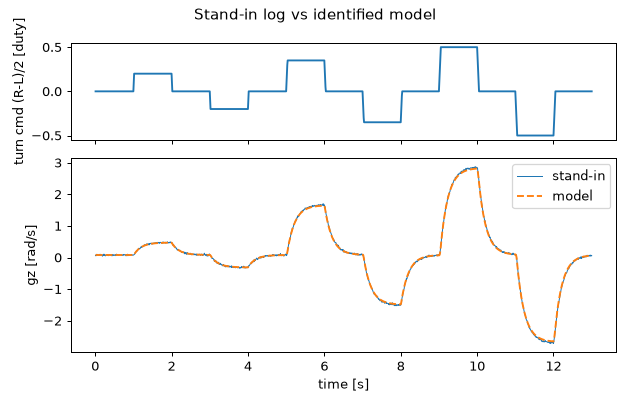

# 05 Real2Sim — ログから sim を直す

sim の数値（モーターのゲイン、時定数、デッドバンド、ジャイロのバイアス）は、最初は当て推量です。
この章では、実機で取ったログ CSV からそれらを推定し（同定）、sim のパラメータ JSON を書き直します。
コードは `src/physlearn/sysid.py` です。

## ログの形

1 行 = 1 step。列は `LOG_COLUMNS`（`t,ax,ay,az,gx,gy,gz,left,right`）。
`left,right` はその step で出した指令（安全ゲートを通った後の値）、IMU の値は step の終わりの観測です。
sim でも実機でも同じ形なので、同じ `sysid` がそのまま使えます。

## 実験の形

`sim.id_experiment()` が同定用の指令列を作ります（その場旋回、dt = 0.01 s、計 13 s）。
旋回成分 u（left = −u、right = +u）を +0.2, −0.2, +0.35, −0.35, +0.5, −0.5 と各 1 s、それぞれの後に 0 を 1 s 入れます。

```
 u
 0.50 ┤                           ┌──┐
 0.35 ┤               ┌──┐        │  │
 0.20 ┤   ┌──┐        │  │        │  │
 0    ┼───┘  └─┐  ┌───┘  └─┐  ┌──┘  └─┐  ┌──
-0.20 ┤        └──┘        │  │        │  │
-0.35 ┤                    └──┘        │  │
-0.50 ┤                                └──┘
      0   1  2  3  4  5  6  7  8  9 10 11 12 13 [s]
      静止   各ステップ 1 s のあと 0 を 1 s
```

符号を交互にするのは、正味の回転を 0 にするためです。実機は USB でつないだまま回すので、同じ向きに回り続けるとケーブルがねじれます。
いちばん大きい 0.5 は、スケッチが切る上限 `DUTY_MAX = 0.6`（と安全ゲートの `max_duty = 0.6`）より下です。
同定は |u| と符号を分けて扱うので、正と負のステップを同じ直線に載せられます（左右のモーターの向きによる差は無いものとみなしています）。

最初の 1 秒は止めておくのが大事です。ここでジャイロのバイアスと雑音を測ります。

## 推定のしかた

1. **バイアスと雑音**: 最初の静止区間の後半の gz の平均と標準偏差。
2. **ゲインとデッドバンド**: 指令が一定の各区間の後ろ 30% を定常とみなす。定常値は `y = K_yaw (u − d)` なので、
   u に対して直線を当てはめると、傾きが K_yaw、y = 0 との交点が d。雑音の 10 倍以上動いた区間だけを使う。
   ```
   y_ss
     │            ●
     │        ●
     │    ●            傾き = K_yaw
     │  ╱
   ──┼─×────────── u
     0  d
   ```
3. **時定数**: 実際に出した指令（安全ゲートで傾斜がついている）で一次遅れのモデルを走らせ、
   τ を 0.01〜2 s の 400 点で振って、ログの gz との二乗誤差が最小のものを選ぶ。

車輪半径とトレッドは IMU だけでは分けられないので、定規で測った値をそのまま使い、
K_yaw からモーターのゲイン K_m = K_yaw · b / (2r) を逆算して JSON に書きます。

## 動かしてみる

まず公称の sim でログを取り、同定して元の値（K_yaw = 12、d = 0.05、τ = 0.08、バイアス 0）が戻るかを見ます。

```
$ uv run physlearn sim-log sim.csv
sim.csv: 1300 行
$ uv run physlearn sysid sim.csv
gyro_bias   -0.0014
gyro_noise  0.0103
yaw_gain    12.0009
deadband    0.0500
motor_tau   0.0804
```

次に、`--plant hidden` で loop-demo の「実機の代役」（隠しパラメータ: K_m = 20 → K_yaw = 8、τ = 0.2、d = 0.15、バイアス 0.08、雑音 0.015）
のログを取り、同定して JSON を書きます。

```
$ uv run physlearn sim-log --plant hidden real.csv
real.csv: 1300 行
$ head -3 real.csv
t,ax,ay,az,gx,gy,gz,left,right
0.01,0.06520000225650686,0.04735404815646211,9.774813238209651,-0.018981322065690788,-0.009349116938060283,0.08061988969020865,-0.0,0.0
0.02,-0.11625153873194172,-0.010939583196627287,9.747704452637347,-0.010984010320551773,-0.008163884742859649,0.07525549765446268,-0.0,0.0
$ uv run physlearn sysid real.csv --out fixed.json
gyro_bias   0.0780
gyro_noise  0.0154
yaw_gain    7.8597
deadband    0.1499
motor_tau   0.1958
→ fixed.json
$ cat fixed.json
{
  "wheel_radius": 0.016,
  "track": 0.08,
  "motor_gain": 19.649295318851745,
  "motor_tau": 0.19579712627720688,
  "deadband": 0.14993092606791045,
  "gyro_bias": 0.07797023420945172,
  "gyro_noise": 0.015391657956207713,
  "accel_noise": 0.05
}
```



上の図は、代役のログに、同定して直したパラメータのモデルを重ねたものです。直す前（01 章の図）と違い、2 本の線がほぼ重なります。

（`-0.0` は left = −u に u = 0 を入れた結果で、0 と同じです。）

`--plant mujoco` にすると MuJoCo の車体（08 章）で同じ実験をします。MuJoCo は任意の依存なので `uv sync --extra mujoco` が要ります。
IMU には雑音とジャイロのバイアス（gz に +0.02 rad/s）を足してあります。

```
$ uv run --extra mujoco physlearn sim-log --plant mujoco mj.csv
mj.csv: 1300 行
$ uv run --extra mujoco physlearn sysid mj.csv
gyro_bias   0.0193
gyro_noise  0.0051
yaw_gain    17.9560
deadband    0.0000
motor_tau   0.0704
```

## 静止だけのログ

モーターをつながない XIAO 単体では、静止のログしか取れません。動いたステップが 2 つ未満のログでは、
`sysid` はジャイロのバイアスと雑音だけを返し、ゲイン・時定数・デッドバンドは元の値のまま残します（エラーにはしません）。
次は代役の sim で 3 秒止めたままのログ `still.csv` を作って試したものです。

```
$ uv run physlearn sysid still.csv --out still.json
gyro_bias   0.0780
gyro_noise  0.0158
動いたステップが 2 つ未満なので、ゲイン・時定数・デッドバンドは推定しない（元の値のまま）
→ still.json
```

`still.json` の `motor_gain` などは公称値（30.0 など）のままで、`gyro_bias` と `gyro_noise` だけが変わります。

## 実機のログで使うとき

実機のログは 03 章の `python -m physlearn.link` で取ります。

- `python -m physlearn.link still ...` の静止ログ → 上の「静止だけのログ」と同じ扱いで、バイアスと雑音だけが出ます。
- `python -m physlearn.link step ...` のログ → 同定にはこの章の `id_experiment` と同じ形（符号交互の 6 段）が要ります。
  1 段だけのステップのログでは、動いたステップが 2 つ未満なのでバイアスと雑音だけが出ます。
  `step` が `id_experiment` の形を流すようになっているかは、この章を書いた時点では【未確認】です（03 章の担当が作業中）。

どちらも `physlearn sysid log.csv --out fixed.json` で読めるはずですが、次は **確かめていません**: 実機のログでの動作、左右のモーターの差（このモデルは左右同じとみなす）、
電池の電圧でゲインが変わること、床との滑り。実機では最初の静止区間で本当に止まっているか（机を揺らさない）を確かめてください。

## 演習

1. `id_experiment` の最初の静止区間を 0.1 s に縮めると `sysid` はどうなるか。なぜそう作ってあるか。
2. ステップの振幅をすべてデッドバンドより小さくすると、`sysid` は何を返すか。なぜそうなるか。
3. `Params(gyro_noise=0.05)` でログを取り、推定値のずれがどの量で大きくなるか調べる。
