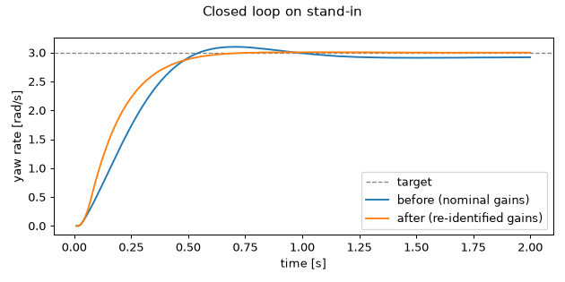

# 07 輪を 1 周回す — loop-demo

04〜06 章の部品をつないで、Sim2Real と Real2Sim の輪を 1 周回します。
実機が手元に無くても回せるように、「隠しパラメータを持つ別の sim」を実機の代役にします（`physlearn.HIDDEN`）。MuJoCo の車体を代役にすることもできます（後半）。

```
  ┌──────────── S2R ────────────┐
  │                             ↓
 [sim] ── ゲインを決める ──→ [実機 (代役)] ── 走らせる ──→ 性能を測る
  ↑                             │
  │                             ↓ 同定用の開ループ実験のログ
  └── sim を直す ←── 同定 ←─────┘
  └──────────── R2S ────────────┘
```

## 手順

1. 公称の sim（`Params()`）で t_c を探し、ゲインを決める。
2. 代役で 0 → 3 rad/s のステップを走らせ、仕様を満たすかを見る。
3. 代役で同定用の開ループ実験（05 章）をしてログを取り、同定して sim を直す。
4. 直した sim で t_c を探し直し、ゲインを決め直す。
5. 代役でもう一度走らせる。

## 動かしてみる

```
$ uv run physlearn loop-demo
仕様: 0 → 3 rad/s のステップで {'settle': 0.6, 'overshoot': 0.1, 'ss_error': 0.05}
[前 (公称の sim)] tc=0.08  sim での通過率 100%  代役で: 整定 0.64 s  行き過ぎ 5.8 %  定常偏差 0.081 rad/s  仕様 NG
代役のログから同定: {'gyro_bias': 0.08, 'gyro_noise': 0.012, 'yaw_gain': 7.867, 'deadband': 0.15, 'motor_tau': 0.196}
[後 (同定した sim)] tc=0.2  sim での通過率 68%  代役で: 整定 0.50 s  行き過ぎ 0.1 %  定常偏差 0.001 rad/s  仕様 OK
```

## 読み方

- **前**: 公称の sim の上では通過率 100 % でしたが、代役では整定 0.64 s（仕様 0.6）と定常偏差 0.081 rad/s（仕様 0.05）の 2 つで外れました。
  定常偏差は、代役のジャイロの 0.08 rad/s のバイアスを制御器が知らず「gz = 3」に合わせてしまうためです。
  整定は、代役の車体が公称より遅い（τ = 0.2 s 対 0.08 s）のに、公称の速い t_c = 0.08 で設計したゲインのままだからだと考えています。
- **同定**: 代役の隠しパラメータ（K_yaw = 8、d = 0.15、τ = 0.2、バイアス 0.08、雑音 0.015）に近い値が戻りました。雑音だけは 0.012 と小さめに出ています（静止区間の後半 50 点だけで測っているため、と考えていますが確かめていません）。
- **後**: バイアスを引くようになり定常偏差は 0.001 rad/s に、遅い車体に合わせて t_c = 0.2 を選び直したので整定も 0.50 s になりました。直した sim での通過率は 68 % で、
  前（100 %）より低いのは、代役の車体がもともと遅く、ばらつきの幅に対して余裕が小さいからだと考えています（06 章）。
  「sim の上の数字が下がったのに実機では良くなった」のは、sim が実機に近づいて、楽観的でなくなったということです。



上の図は、代役での 0 → 3 rad/s のステップ応答です。前（公称で決めたゲイン）は行き過ぎて目標の少し下に落ち着き、後（同定したパラメータで決め直したゲイン）は目標に揃います。

### 効いたのはバイアスだけか

以前の版のコード（代役 K_yaw = 6、d = 0.2、安全ゲート 0.8）では、「前」が外れたのは定常偏差だけで、改善はほぼバイアスを引くようになった分だけでした。
今の版で確かめるため、公称の `Params()` にバイアス（0.08）だけを入れて t_c を探し、代役で走らせました。

```
$ uv run python -c "
from dataclasses import replace
from physlearn import make_plant
from physlearn.sim import Params
from physlearn.control import design, metrics, run, passes
from physlearn.randomize import tune
p = replace(Params(), gyro_bias=0.08); tc, _ = tune(p)
m = metrics(*run(make_plant('hidden', seed=1000), design(p, tc))[1:])
print(tc, {k: round(v, 3) for k, v in m.items()}, passes(m))"
0.08 {'settle': 0.8, 'overshoot': 0.096, 'ss_error': 0.002} False
```

バイアスだけでは定常偏差は直りますが、整定 0.8 s で仕様を外れます。今の代役では、時定数とゲインの同定も効いています。

## MuJoCo を代役にする

numpy の sim の代役は、同定するモデルと同じ式で出来ています。モデルの形が合っているので、同定が当たるのは当然です。
`--real mujoco` にすると、作りの違う相手（08 章の MuJoCo の車体。接触と慣性から時定数が決まり、デッドバンドが無い）を代役にします。
IMU には雑音とジャイロのバイアス（gz に +0.02 rad/s）を足してあり、性能は雑音なしの真のヨー角速度（`MujocoPlant.yaw_rate`）で測ります。

```
$ uv run --extra mujoco physlearn loop-demo --real mujoco
仕様: 0 → 3 rad/s のステップで {'settle': 0.6, 'overshoot': 0.1, 'ss_error': 0.05}
[前 (公称の sim)] tc=0.08  sim での通過率 100%  代役で: 整定 0.08 s  行き過ぎ 2.6 %  定常偏差 0.020 rad/s  仕様 OK
代役のログから同定: {'gyro_bias': 0.02, 'gyro_noise': 0.004, 'yaw_gain': 17.958, 'deadband': 0.0, 'motor_tau': 0.07}
[後 (同定した sim)] tc=0.08  sim での通過率 100%  代役で: 整定 0.22 s  行き過ぎ 0.1 %  定常偏差 0.000 rad/s  仕様 OK
```

- **前** から仕様を満たしています。MuJoCo の車体は公称より速く（K_yaw ≈ 18、τ ≈ 0.07 s）、バイアスも 0.02 と小さいので、公称のゲインで間に合いました。
- **同定**: デッドバンド 0、τ = 0.07 s、K_yaw ≈ 18 が出ました。08 章で見た「duty 0.5 で gz ≈ 9.0 rad/s、時定数 0.07〜0.08 s」と合います。
  ジャイロの雑音は 0.004 と、足した 0.005 より小さく出ました（numpy の代役と同じく、静止区間の後半 50 点だけで測るため、と考えていますが確かめていません）。
- **後**: 定常偏差は 0.020 → 0.000 rad/s と良くなり、整定は 0.08 → 0.22 s になりました（どちらも仕様の内）。
  これは遅くなったのではありません。同定前は、公称の sim がゲインを約 1.5 倍小さく見積もり（公称 K_yaw = 12、MuJoCo の同定値 17.96）、MuJoCo には無いデッドバンドの FF（0.05）も足していたので、設計の t_c = 0.08 より速く立ち上がっていました。
  同定後は閉ループが設計どおりの一次遅れになり、±5 % の整定は 3·t_c ≈ 0.24 s（実測 0.22 s）です。前のほうが速い理由を、要素を 1 つずつ外して確かめてはいません（[08 章](08-mujoco.md)）。
- この相手では、輪を 1 周回して良くなったのはバイアスの分と、閉ループが設計どおりの形になったことです。それでも数字をそのまま載せます。

## 実機に置き換える

代役のところを実機に置き換えれば、同じ輪が回ります。実機では `python -m physlearn.link` が `Plant` の役をし、安全ゲート（duty 上限 0.6）もその中で通ります。
手順は次の節「実機の経路で 1 周」のコマンドの `--port` を実機のポート（例 `/dev/ttyACM0`）に変えるだけです。立ち上げの順番は [doc/bringup.md](../bringup.md)、配線と書き込みは [03 章](03-hardware-firmware.md)。
静止だけのログでも `physlearn sysid` は動き、バイアスと雑音だけが直ります（05 章）。

実機では真のヨー角速度が無く gz で評価するので、バイアスの推定が外れていると、そのずれは数字に出ません。

## 実機の経路で 1 周

偽の XIAO（12 章）で確かめた。実機では確かめていない。
ここでは Python の中で代役を直に回すのではなく、`python -m physlearn.link` だけを使い、シリアル越しに 1 周します。

```bash
# 端末 1
uv run python -m physlearn.fakexiao             # 表示された /dev/pts/N を使う
# 端末 2
uv run python -m physlearn.link run --port /dev/pts/N --out before.csv          # 公称のパラメータで
uv run python -m physlearn.link id  --port /dev/pts/N --out id.csv
uv run physlearn sysid id.csv --out p.json
uv run python -m physlearn.link run --port /dev/pts/N --params p.json --out after.csv
```

出力（抜粋）:

```text
tc=0.08  kp=0.0833  ki=1.0417  deadband=0.050  bias=0.0000
[+3.0] 整定 0.76 s  行き過ぎ 8.7 %  定常偏差 0.000 rad/s  仕様 NG
[-3.0] 整定 0.88 s  行き過ぎ 11.7 %  定常偏差 0.002 rad/s  仕様 NG
gyro_bias 0.0803  yaw_gain 7.8514  deadband 0.1495  motor_tau 0.1958
tc=0.2  kp=0.1247  ki=0.6368  deadband=0.149  bias=0.0803
[+3.0] 整定 0.52 s  行き過ぎ 1.3 %  定常偏差 0.002 rad/s  仕様 OK
[-3.0] 整定 0.52 s  行き過ぎ 1.5 %  定常偏差 0.000 rad/s  仕様 OK
```

同じ日の `physlearn loop-demo`（代役を直に回し、真のヨー角速度で測る）は、前が 整定 0.64 s・行き過ぎ 5.8 %・定常偏差 0.081 rad/s、後が 0.50 s・0.1 %・0.001 rad/s でした。
差は 3 つあり、どれも「sim と実機の差」の小さな実例です。

- **前の定常偏差 0.081 と 0.000。** シリアル越しには真の角速度が無く、gz − バイアス（公称の 0）で測ります。制御器は gz を 3 に合わせるので、gz で測る限り偏差は 0 に見えます。本当の角速度は 3 − 0.08 です。バイアスのずれは、gz で測る限り見えません。
- **行き過ぎが 1〜3 ポイント大きい。** gz には雑音（偽物では標準偏差 0.015 rad/s）が乗り、その最大値を拾うためだと考えています。0.045 rad/s（3σ）は 3 rad/s の 1.5 % です【推定。分けて測っていない】。
- **前の整定 0.76 s と 0.64 s。** 雑音が ±5 % の帯の出入りを増やすこと、負の向きは正の回と別の雑音を引くことが効くと考えています【未確認】。
  同じゲイン（t_c = 0.15、同定後）で比べた試験 `tests/test_real_loop.py` では、直に回すと 整定 0.34 s・行き過ぎ 3.9 %、シリアル越しでは 0.34 s・4.8 % でした。1 step の遅れによる差は、この偽物では見えませんでした（偽物の遅れはほぼ 0。本物の USB の遅れは【未確認】）。

## 演習

1. `HIDDEN` のバイアスを 0 にして loop-demo を回すと、「前」は仕様を満たすか。外れるなら、どの量で外れるか。
2. `HIDDEN` の `motor_tau` を 0.4 にすると、「後」の t_c と結果はどう変わるか。
3. 同定に使うログを、開ループ実験ではなく「前」の閉ループ走行のログにすると `sysid` はどうなるか（ヒント: 指令が一定の区間がほとんど無い）。
