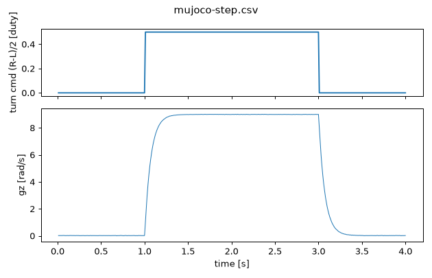

# 8. MuJoCo で車体を動かす

## なぜ物理エンジンも使うのか

numpy の sim は、モーターと車体の式を自分で書いたものです。式が見えるので学ぶには一番よいのですが、書いたことしか起きません。
MuJoCo のような物理エンジンを使うと、次のことを自分で書かずに済みます。

- **接触**: 車輪が床を押す力、キャスターが床に乗っていること。
- **摩擦**: 車輪が滑るかどうか。急に大きなトルクをかけたときの空転。
- **慣性**: 車体の重さと形から、回りにくさが自動で決まる。

もう一つの使い道は **sim-to-sim** です。MuJoCo の車体を「実機の代役」にして、そのログから numpy の sim のパラメーターを同定する (R2S) 練習ができます。
実機と違って答え（MJCF に書いた値）が分かっているので、同定がどれだけ当たったかを確かめられます。

## 入れ方と走らせ方

MuJoCo は任意の依存です。GPU も画面も要りません（この章では描画はせず、物理だけを回します）。

```sh
uv sync --extra mujoco
uv run --extra mujoco pytest -q tests/test_mujoco_plant.py
uv run --extra mujoco physlearn sim-log --plant mujoco log.csv
```

使った版は `mujoco 4.0.1` です。
最後のコマンドは、numpy の sim と同じ同定用の実験（05 章の `id_experiment`。静止 1 秒のあと符号交互のステップ、計 13 秒）を
安全ゲート越しに 0.01 秒刻みで回し、`t,ax,ay,az,gx,gy,gz,left,right` の CSV（1 行 = 1 step）を書きます。
IMU には雑音とジャイロのバイアス (gz に +0.02 rad/s) を足してあります。`--seed` で雑音の乱数を変えられます。

Python からは `Plant` として使えます。

```python
from physlearn.api import Command
from physlearn.mujoco_plant import MujocoPlant

plant = MujocoPlant()            # 雑音つき: MujocoPlant(noise_acc=0.05, noise_gyro=0.005, bias_gyro=(0, 0, 0.02), seed=1)
obs = plant.reset()
obs = plant.step(Command(left=-0.5, right=0.5), dt=0.01)
```

## MJCF の読み方

モデルは `src/physlearn/models/diffdrive.xml` です。上から順に読みます。

1. `<option timestep="0.002">`: 物理を 2 ms 刻みで解きます。`step(cmd, dt=0.01)` は中で 5 回回ります。
2. `<geom name="floor" type="plane">`: 床。`friction` は（滑り、ねじり、転がり）の 3 つの摩擦係数です。
3. `<body name="chassis">` と `<freejoint/>`: 車体。freejoint で空間を自由に動けます。箱 (`box`) は 0.25 kg。
4. `caster_front`・`caster_rear`: 前後のキャスターの代わりの小さな球。`condim="1"` は「押す力だけで摩擦なし」の接触です。
   MuJoCo は 2 つの geom の condim の大きい方を使うので、`priority="1"` で床より優先させています（これが無いと球に摩擦がつき、旋回が大きく遅れました）。
5. `<site name="imu">`: IMU を付ける場所。軸の向きを車体と同じ（x 前・y 左・z 上）にしてあるので、センサーの値をそのまま `Obs` に入れられます。
6. `left_wheel`・`right_wheel`: 車輪。`hinge` の軸は +y で、+y 回りに回すと前進します。半径 0.03 m、左右の間隔（トレッド）0.10 m、各 0.02 kg。
   形は円柱でなく球にしました。円柱で試すと縁で接触が跳ねて、gz がぎざぎざになったためです。
7. `<actuator>` の `general`: モーター。トルクは

   トルク = 0.05 × duty − (0.05 / 30) × 車輪の角速度　[N m]

   DC モーターは回るほど逆起電力でトルクが落ちます。この「速度に比例して落ちる」形を `biastype="affine"` と `biasprm` の 3 番目（速度の係数）で書いています。
   停動トルク 0.05 N m、無負荷で 30 rad/s です。一次遅れのフィルターを置く方法もありますが、こちらにすると時定数が車体の重さから自然に決まります（重くすれば遅くなる）。
8. `<sensor>`: `accelerometer` と `gyro`。加速度計は重力の反対向きを感じるので、静止時に az = +9.81 になります。

## 実際に走らせた結果

`MujocoPlant` は雑音なしの真のヨー角速度を `yaw_rate` で返します（平らな床なので、雑音を足す前のジャイロ z と同じ）。
制御の性能はこれで測ります。実機には無い値なので、制御器が見てはいけないのは numpy の sim と同じです。

上のコマンドで書いたログの最初の 2 行（静止中）は次のとおりで、gz に 0.02 前後のバイアスが乗っています。

```
t,ax,ay,az,gx,gy,gz,left,right
0.010000000000000009,0.06520000225650686,0.0473540481564621,9.774813241074696,-0.0063271073552302595,-0.003116372312686761,0.020206629896736217,-0.0,0.0
0.020000000000000018,-0.11625153873194172,-0.01093958319662726,9.747704454176965,-0.0036613367735172596,-0.0027212949142865497,0.01841849921815423,-0.0,0.0
```

このログを 05 章の `sysid` で同定すると次のようになりました。

```
$ uv run --extra mujoco physlearn sysid log.csv
gyro_bias   0.0193
gyro_noise  0.0051
yaw_gain    17.9560
deadband    0.0000
motor_tau   0.0704
```

- バイアス 0.0193・雑音 0.0051 は、足した 0.02・0.005 にほぼ一致します。
- K_yaw ≈ 18 は、duty 0.5 で gz ≈ 9.0 rad/s になることに当たります。式から見積もると、duty 0.5 で車輪は 15 rad/s、車輪の速さ 0.45 m/s、gz = 2 × 0.45 / 0.10 = 9.0 rad/s で、合います。
- デッドバンドは 0 です。モーターのトルクは duty に比例して 0 から出て、MJCF に静止摩擦を入れていないためです。
- 時定数 0.0704 s は、numpy の一次遅れを当てはめた値です。MuJoCo では車体の慣性とモーターの逆起電力から決まる値で、63 % に届く時間を測ったときの 0.07〜0.08 s と合います。



上の図は、このログ（`--plant mujoco`、seed 0）の指令と gz です。公称の sim（04 章の図）より大きく回り、段ごとの立ち上がりも速く見えます。

このログを使った「実機の代役」としての 1 周は 07 章にあります。

## numpy の sim との違いが出そうなところ

確かめてはいませんが、次のところで差が出ると考えられます。

- **滑り**: duty を急に大きくすると、車輪が床に対して滑ることがあります。numpy の sim が「滑らない」と仮定していれば、立ち上がりがそちらより速く見えるはずです。
- **慣性の決まり方**: 時定数は MJCF の質量・形・モーター係数から決まります。numpy の sim では時定数を直接パラメーターとして与えているなら、同定した時定数は「MuJoCo の車体の全部をまとめた一つの数」になります。
- **加速度計**: 旋回中、IMU が回転中心からずれていれば遠心力が ay に出ます。このモデルは IMU を車軸の真ん中に置いているので小さく、出したログで ax・ay に何が出ているかはまだ詳しく見ていません。
- **接触の細かい揺れ**: 物理エンジンは接触を少しやわらかく解くので、静止中にもごく小さな値（1e-17 程度）がセンサーに出ます。

## 演習

1. `diffdrive.xml` の車体の質量を 0.25 から 0.5 kg に変えて、`sim-log --plant mujoco` と `sysid` で時定数がどう変わるか測ってください。定常の gz は変わるでしょうか。それはなぜでしょう。
2. `physlearn sim-log --plant mujoco log.csv` のログから、静止中の gz の平均を取ってジャイロのバイアスを推定してください。何秒ぶんの静止があれば 0.001 rad/s の精度で当てられるでしょう。
3. （sim-to-sim）MuJoCo のログで numpy の sim の時定数とゲインを同定し、同じ指令で numpy の sim を回して gz を重ねて比べてください。どこが合い、どこが合わないでしょうか。
